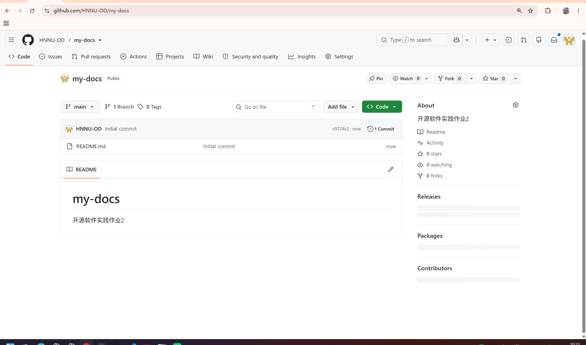
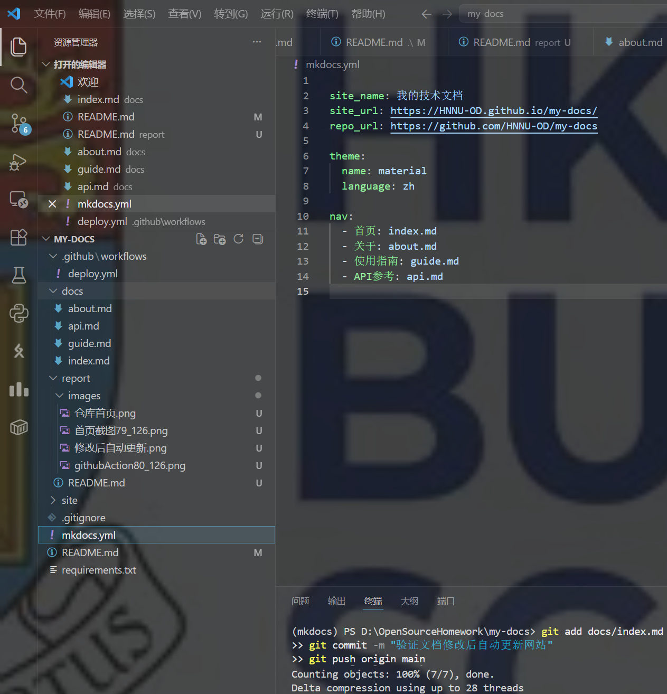
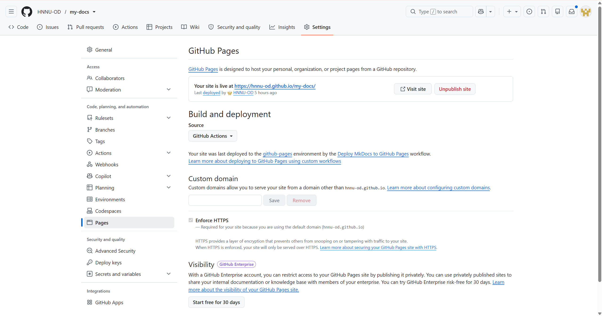
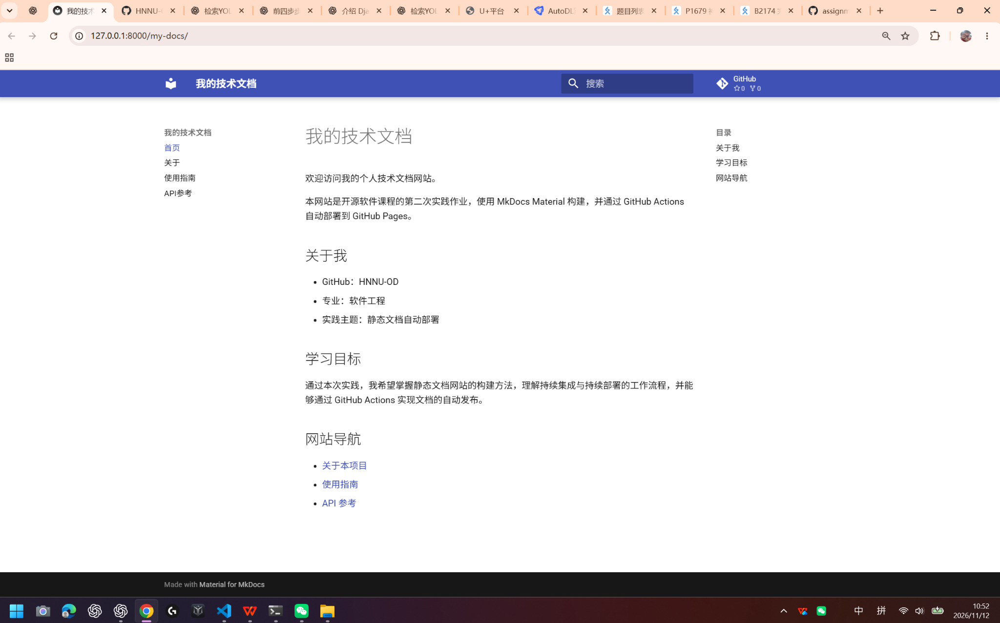
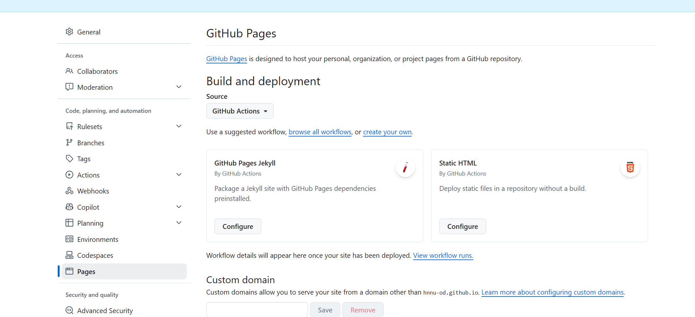
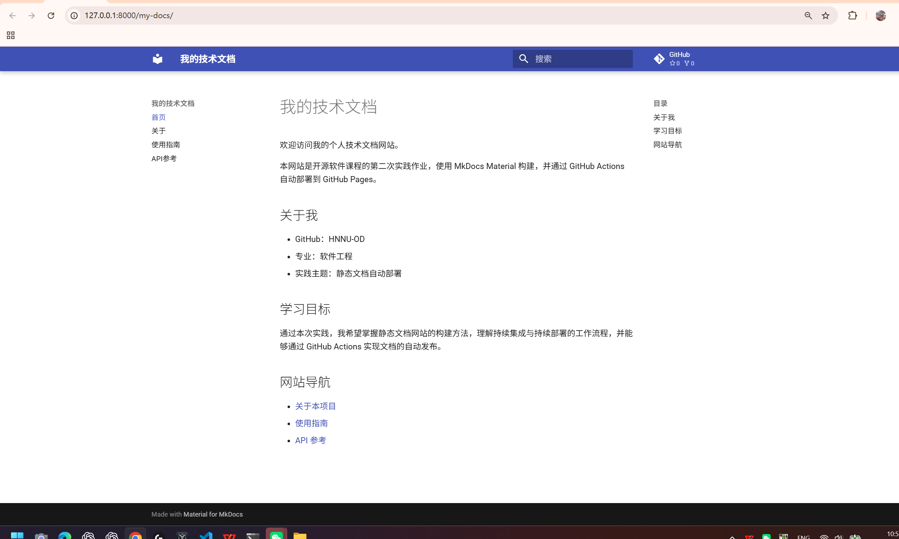
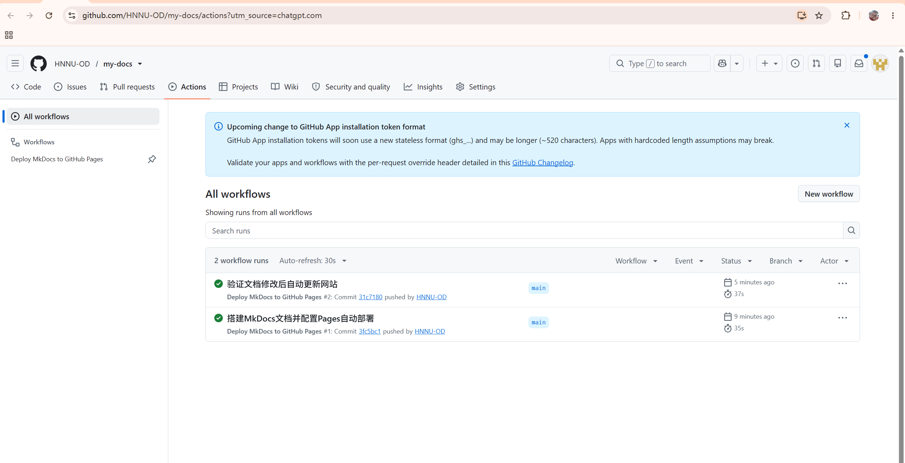
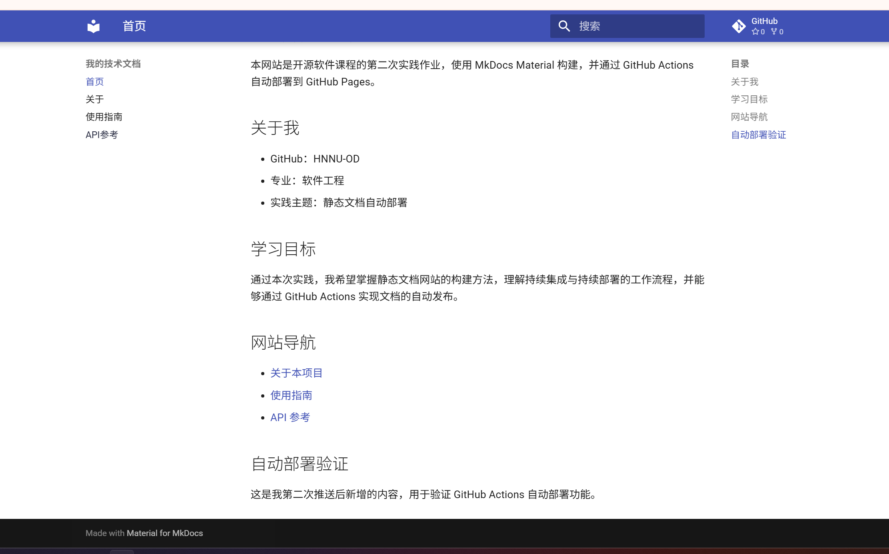

# 实践项目2：个人实验报告

## 1. 基本信息

- 姓名：胡嘉豪
- 学号：202430224010
- GitHub 登录名：HNNU-OD
- 个人仓库地址：https://github.com/HNNU-OD/my-docs
- 最终网站地址：https://hnnu-od.github.io/my-docs/
- 实验日期：2026年11月12日

## 2. 实践过程与关键截图

### 2.1 仓库创建

首先使用本人 GitHub 账号 HNNU-OD 创建名为 `my-docs` 的公开仓库，选择 Public，并初始化 README 文件，将 `main` 设置为默认分支。

随后，在 Windows PowerShell 中执行以下命令，将远程仓库克隆到本地：

```powershell
cd D:\OpenSourceHomework
git clone https://github.com/HNNU-OD/my-docs.git
cd my-docs
code .
```

克隆成功后，在 VS Code 中打开项目，完成本地开发环境准备。仓库属于本人账号且为公开仓库，满足个人作业要求。



### 2.2 项目结构与 MkDocs 配置

在项目根目录创建 `docs/`、`.github/workflows/` 和 `report/images/` 等目录，并编写四个 Markdown 页面及相关配置文件。

项目结构如下：

```text
my-docs/
├── .github/
│   └── workflows/
│       └── deploy.yml
├── docs/
│   ├── index.md
│   ├── about.md
│   ├── guide.md
│   └── api.md
├── report/
│   ├── README.md
│   └── images/
├── mkdocs.yml
├── requirements.txt
├── .gitignore
└── README.md
```

四个 Markdown 页面分别为：

- `index.md`：网站首页，包含个人介绍、学习目标和页面导航链接。
- `about.md`：关于项目，包含项目介绍、技术组成表格及工作流程。
- `guide.md`：使用指南，包含依赖安装、本地预览和网站构建命令。
- `api.md`：API 参考，包含接口说明、JSON 返回示例和字段说明。

其中，`docs/` 保存网站 Markdown 源文档，`mkdocs.yml` 用于配置网站名称、主题、访问地址和导航结构，`nav` 定义四个页面的导航关系。

MkDocs 配置如下：

```yaml
site_name: 我的技术文档
site_url: https://HNNU-OD.github.io/my-docs/
repo_url: https://github.com/HNNU-OD/my-docs

theme:
  name: material
  language: zh

nav:
  - 首页: index.md
  - 关于: about.md
  - 使用指南: guide.md
  - API参考: api.md
```

在 `requirements.txt` 中声明项目依赖：

```text
mkdocs>=1.6,<2
mkdocs-material>=9.6,<10
```

在 `.gitignore` 中配置：

```gitignore
site/
.venv/
__pycache__/
```

通过上述配置，实现了中文 Material 主题及四页导航。`site/` 是 MkDocs 自动生成的静态网站目录，不需要手工编写或提交到 main 分支。`.gitignore` 可以避免将构建产物、虚拟环境和缓存文件上传至 GitHub。



### 2.3 本地构建或预览

检查本地 Python 环境后发现，Anaconda 基础环境使用 Python 3.13.5。为与作业要求保持一致，使用 Conda 创建 Python 3.12 独立环境，并安装项目依赖。

在 PowerShell 中执行：

```powershell
conda create -n mkdocs python=3.12 -y
conda activate mkdocs
python --version
python -m pip install -r requirements.txt
```

依赖安装完成后，执行严格构建命令：

```powershell
python -m mkdocs build --strict
```

该命令将 Markdown 源文档转换为静态网站文件，并生成 `site/` 目录。

随后启动本地预览服务：

```powershell
python -m mkdocs serve
```

在浏览器中访问：

http://127.0.0.1:8000/my-docs/

本地网站成功显示中文 Material 主题、首页内容及四页导航链接，说明本地预览服务正常运行。

通过本地预览，可以在正式部署前检查文档内容、页面结构、导航链接和主题配置，减少自动部署过程中出现错误的可能性。



### 2.4 Pages 设置

在个人 GitHub 仓库中进入 `Settings → Pages → Build and deployment`，将 Source 设置为 GitHub Actions。

本实验采用 GitHub 官方 Pages Actions 部署方式，由工作流上传静态网站构建产物并完成发布，不需要创建 `gh-pages` 分支，也无需自行申请访问令牌或开启创建、批准 PR 的权限。

这种方式可以将网站源代码与生成的静态网站文件分离，保持 main 分支结构清晰。



### 2.5 Actions 首次构建和部署

在 `.github/workflows/deploy.yml` 中配置 GitHub Actions 自动部署工作流，名称为 `Deploy MkDocs to GitHub Pages`。

完整工作流配置如下：

```yaml
name: Deploy MkDocs to GitHub Pages

on:
  push:
    branches: [main]
    paths:
      - 'docs/**'
      - 'mkdocs.yml'
      - 'requirements.txt'
      - '.github/workflows/deploy.yml'
  workflow_dispatch:

permissions:
  contents: read

concurrency:
  group: pages
  cancel-in-progress: false

jobs:
  build:
    runs-on: ubuntu-latest
    steps:
      - name: Checkout source
        uses: actions/checkout@v7

      - name: Set up Python
        uses: actions/setup-python@v7
        with:
          python-version: '3.12'

      - name: Configure Pages
        uses: actions/configure-pages@v5

      - name: Install dependencies
        run: python -m pip install -r requirements.txt

      - name: Build documentation
        run: python -m mkdocs build --strict

      - name: Upload site artifact
        uses: actions/upload-pages-artifact@v4
        with:
          path: site

  deploy:
    needs: build
    runs-on: ubuntu-latest
    permissions:
      pages: write
      id-token: write
    environment:
      name: github-pages
      url: ${{ steps.deployment.outputs.page_url }}
    steps:
      - name: Deploy to GitHub Pages
        id: deployment
        uses: actions/deploy-pages@v4
```

工作流主要包括两个任务：

| 任务 | 主要功能 |
| --- | --- |
| build | 获取源码、配置 Python 3.12、安装依赖、严格构建网站并上传 site/ 构建产物 |
| deploy | 在 build 成功后，将构建产物发布到 GitHub Pages |

工作流通过 `push` 事件监听 main 分支指定文件的变化，使用 `workflow_dispatch` 支持手动运行，并通过 `needs: build` 保证部署任务在构建成功之后执行。

完成配置后，执行以下命令提交并推送项目：

```powershell
git add docs mkdocs.yml requirements.txt .gitignore .github/workflows/deploy.yml README.md

git commit -m "搭建MkDocs文档并配置Pages自动部署"

git push origin main
```

推送成功后，GitHub Actions 自动执行构建和部署任务，首次工作流运行成功，完成网站发布。

首次部署相关记录：

- 首次提交：[3fc5bc1](https://github.com/HNNU-OD/my-docs/commit/3fc5bc10f7b2df6244163fa33e4a9a729e697753)
- 首次 Actions 运行：[查看运行记录](https://github.com/HNNU-OD/my-docs/actions/runs/43145323779)



### 2.6 网站访问与四页导航检查

首次部署成功后，通过浏览器访问 GitHub Pages 网站：

https://hnnu-od.github.io/my-docs/

网站使用 Material 主题，具有侧边导航栏、正文区域及搜索功能。

网站包含以下四个页面：

| 页面 | 检查内容 |
| --- | --- |
| 首页 | 个人介绍、学习目标及页面间链接 |
| 关于 | 项目介绍、技术组成表格及工作流程 |
| 使用指南 | 依赖安装、构建及本地预览命令 |
| API参考 | 接口描述、JSON代码示例及字段说明表格 |

四个页面的访问地址如下：

- [首页](https://hnnu-od.github.io/my-docs/)
- [关于](https://hnnu-od.github.io/my-docs/about/)
- [使用指南](https://hnnu-od.github.io/my-docs/guide/)
- [API参考](https://hnnu-od.github.io/my-docs/api/)

网站首页已成功访问，四个页面的导航入口均已显示。通过首页可以进入各子页面，各子页面包含对应的正文内容、表格、代码块及页面间链接。

本次部署实现了从本地 Markdown 文档到公开静态网站的转换，网站不再依赖本地 MkDocs 预览服务，可以通过 GitHub Pages 提供的地址进行访问。



### 2.7 第二次推送与自动更新验证

为了验证网站能否在源文档修改后自动更新，在 `docs/index.md` 末尾增加以下内容：

```markdown
## 自动部署验证

这是我第二次推送后新增的内容，用于验证 GitHub Actions 自动部署功能。
```

保存修改后，执行：

```powershell
git add docs/index.md
git commit -m "验证文档修改后自动更新网站"
git push origin main
```

第二次推送后，GitHub Actions 自动触发新的运行，无需手动部署。该工作流触发事件为 `push`，最终运行结果为 `success`。



部署成功后，刷新 GitHub Pages 网站，检查首页新增的“自动部署验证”内容。

网站更新效果如下：



通过此次实验，验证了完整的自动化部署流程：

```text
修改 Markdown 文档
        ↓
Git 提交并推送至 main 分支
        ↓
GitHub Actions 自动触发
        ↓
MkDocs 自动构建静态网站
        ↓
GitHub Pages 自动部署
        ↓
公开网站内容更新
```

该流程说明，在完成自动化工作流配置后，后续只需要维护 Markdown 源文档并推送至远程仓库，即可实现网站内容的自动构建和发布，减少了重复的手工部署操作。

- 对应提交链接：https://github.com/HNNU-OD/my-docs/commit/31c7180d490a44dd768818f1a1aaeb4870a4f24f
- 对应 Actions 运行链接：https://github.com/HNNU-OD/my-docs/actions/runs/43145773897

## 3. 问题与解决

### 3.1 Python 环境版本不一致

**问题现象：**

本地 Anaconda 基础环境的 Python 版本为 3.13.5，与实验要求的 Python 3.12 不一致。

**原因分析：**

本机已有的 Python 环境版本与课程指定版本不同。为保持本地开发与自动部署环境一致，需要单独配置 Python 3.12 环境。

**解决操作：**

使用 Conda 创建独立的 Python 3.12 环境：

```powershell
conda create -n mkdocs python=3.12 -y
conda activate mkdocs
python -m pip install -r requirements.txt
```

通过独立环境安装 MkDocs 及 Material 主题，避免直接修改原有 Anaconda 基础环境。

**解决结果：**

本地网站成功构建与预览，Python 环境与 GitHub Actions 中配置的 Python 版本保持一致。

### 3.2 Git 推送时网络连接超时

**问题现象：**

首次执行 `git push origin main` 时，出现以下错误：

```text
error: RPC failed; curl 28 Failed to connect to github.com port 443
send-pack: unexpected disconnect while reading sideband packet
fatal: the remote end hung up unexpectedly
```

重新执行推送命令后，仍然提示无法连接 GitHub 服务器，导致本地代码无法正常上传。

**原因分析：**

Git 无法通过当前网络稳定连接 GitHub 的 HTTPS 服务，导致远程推送连接超时。该问题属于网络连接问题，与 MkDocs 配置及本地代码提交无关。

**解决操作：**

为 Git 配置本地正在使用的 HTTP 代理：

```powershell
git config --global http.proxy http://127.0.0.1:7890
git config --global https.proxy http://127.0.0.1:7890
```

随后重新执行：

```powershell
git push origin main
```

**解决结果：**

Git 成功将本地代码推送到 GitHub，终端显示：

```text
c9724c2..3fc5bc1  main -> main
```

远程 main 分支成功更新，随后 GitHub Actions 自动执行构建与部署，网络连接问题得到解决。

由于使用全局代理配置，后续 Git 操作需要注意代理服务是否可用。

## 4. 原理理解

### 4.1 docs/ 和 site/ 各保存什么？为什么不用手工修改 site/？

`docs/` 保存 Markdown 格式的网站源文件，是文档内容的编辑和维护对象。

`site/` 保存 MkDocs 根据源文件及配置生成的 HTML、CSS、JavaScript 等静态网站资源，是网站的构建产物。

每次构建时，MkDocs 会根据源文档重新生成 `site/`，因此手工修改其中的文件可能在下一次构建时被覆盖。

正确做法是修改 `docs/` 或 `mkdocs.yml`，再通过 MkDocs 重新生成网站。

在本次实验中，`site/` 通过 GitHub Actions 上传并部署，不需要提交到 main 分支。

### 4.2 本次工作流在什么情况下自动运行？

本次工作流通过 `push` 事件及 `paths` 配置实现自动触发。

当 main 分支收到涉及以下文件的推送时，GitHub Actions 自动运行：

```text
docs/**
mkdocs.yml
requirements.txt
.github/workflows/deploy.yml
```

因此，修改网站 Markdown 文档、网站配置、依赖配置或自动部署工作流后，只要提交并推送到 main 分支，就能够触发自动构建与部署。

此外，`workflow_dispatch` 允许在 Actions 页面手动运行工作流，用于排错或重新部署。

### 4.3 build 与 deploy 两个任务有什么区别？

build 是构建任务，主要负责：

1. 获取 GitHub 仓库源码。
2. 配置 Python 运行环境。
3. 安装 MkDocs 及相关依赖。
4. 执行 `python -m mkdocs build --strict` 构建网站。
5. 上传生成的 `site/` 构建产物。

deploy 是部署任务，主要负责将 build 生成的静态网站构建产物发布到 GitHub Pages，使网站能够通过公开地址访问。

工作流通过 `needs: build` 声明任务依赖关系，确保只有 build 成功后才执行 deploy。

`pages: write` 和 `id-token: write` 为 GitHub Pages 官方部署流程提供所需权限。

因此，build 负责生成网站，deploy 负责发布网站，两者共同组成自动化构建与部署流程。

### 4.4 只修改 report/README.md 会触发部署吗？为什么？

不会。

工作流的 `paths` 配置只监听网站源文档、MkDocs 配置、依赖文件和工作流文件，不包含 `report/README.md`。

如果一次推送只修改实验报告或报告截图，不会触发网站自动部署。

这样可以避免因实验报告内容发生变化而产生不必要的构建和部署任务，提高自动化工作流的运行效率。

### 4.5 本次方案为何无需创建 gh-pages 分支？

传统的 GitHub Pages 部署方式通常需要使用专门的 `gh-pages` 分支保存生成后的静态网页。

本次实验使用 GitHub 官方 Pages Actions 部署方式，将网站发布来源设置为 GitHub Actions。

在 build 阶段，通过 `actions/upload-pages-artifact` 上传生成的 `site/` 构建产物；在 deploy 阶段，通过 `actions/deploy-pages` 将构建产物直接发布到 GitHub Pages。

因此，无需创建 `gh-pages` 分支保存静态网页，也不需要将生成的 HTML 文件提交至 main 分支。

该方式实现了网站源文件与构建产物的分离，使源码仓库结构更加清晰，同时简化了静态网站的自动发布过程。

通过本次实验，我掌握了从 Markdown 文档编写、MkDocs 静态网站构建到 GitHub Actions 自动部署的完整流程，并理解了持续集成与持续部署在软件开发过程中的实际作用。